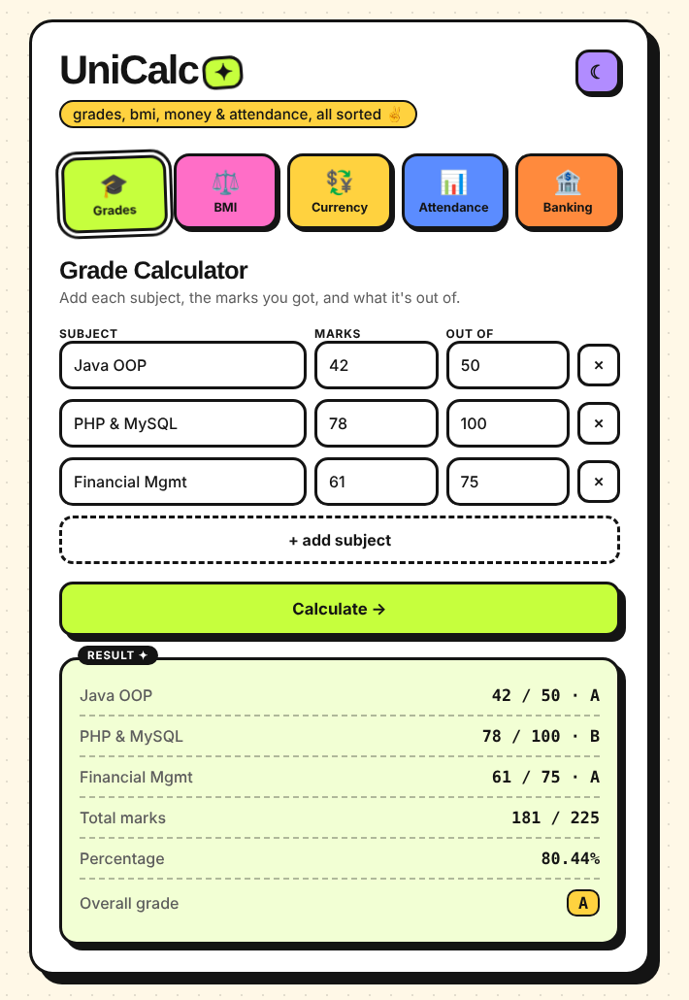
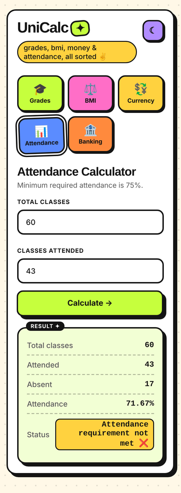
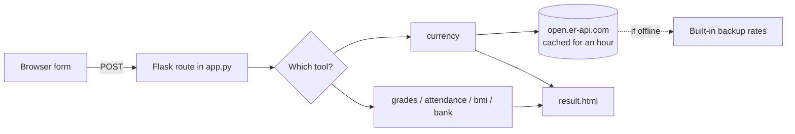

<picture>
  <source media="(prefers-color-scheme: dark)" srcset="docs/readme/banner-dark.svg">
  
</picture>

**[Open the live app](https://unicalculator.onrender.com)**. Built with Python and Flask, with no database and no build step.

Students end up with the same five tabs open every semester: a percentage calculator for marks, an attendance checker for the 75% rule, a currency converter, a BMI site full of ads, and something to track money. UniCalc puts them in one place.

It was my first complete web project, so it's deliberately small: one Flask file, plain HTML, CSS and JavaScript, and it runs anywhere Python does.

<table>
  <tr>
    <td width="62%"></td>
    <td width="38%"></td>
  </tr>
  <tr>
    <td><sub>Marks out of different totals, combined properly. 42/50, 78/100 and 61/75 come to 80.44%.</sub></td>
    <td><sub>On a phone: 43 of 60 classes is 71.67%, so it warns you.</sub></td>
  </tr>
</table>

## What it does

| Tool | What you give it | What you get back |
|---|---|---|
| Grade calculator | Each subject's marks and what it's out of (42/50, 78/100…) | Grade per subject, total, percentage and overall grade |
| Attendance | Total classes and classes attended | Your percentage and whether you meet the 75% rule |
| Currency converter | An amount and two currencies | The converted amount, using live rates for 150+ currencies |
| BMI | Height and weight, in metric or US units | Your BMI and its category (adults 20+) |
| Mini bank | Deposits and withdrawals | A running balance, for practising the logic of a bank account |

It also has a light and dark theme, works on a phone, can be used with just a keyboard, and turns off animation if your system asks for reduced motion.

<details>
<summary>Grading scale</summary>

| Percentage | Grade |
|---|---|
| 90 and above | A+ |
| 80 – 89 | A |
| 70 – 79 | B |
| 60 – 69 | C |
| 50 – 59 | D |
| Below 50 | F |

You can change it in the `GRADES` list at the top of `app.py`.
</details>

## How it's built



Each calculator is a small function in `app.py` that validates the input and returns a result. Currency rates are fetched once an hour and cached; if the rate service is down, the app falls back to a built-in table instead of failing.

## Run it on your computer

```bash
git clone https://github.com/binayakmandal-hash/unicalculator.git
cd unicalculator
python -m venv venv
venv\Scripts\activate          # macOS / Linux: source venv/bin/activate
pip install -r requirements.txt
python app.py
```

Then open http://localhost:5000.

## Put it online

It's set up for Render's free plan. Create a new **Web Service** from this repo and use:

- Build command: `pip install -r requirements.txt`
- Start command: `gunicorn app:app --workers 1 --bind 0.0.0.0:$PORT`

The free plan sleeps when nobody is using it, so the first visit can take about a minute.

## Project layout

```
unicalculator/
├── app.py              all five calculators and the Flask routes
├── templates/
│   ├── index.html      the main page with the tabs
│   └── result.html     the result card
├── static/
│   ├── style.css       the bold, sticker-style theme
│   └── script.js       tabs, theme toggle, adding subject rows
├── requirements.txt    Flask and Gunicorn
└── Procfile            start command for Render
```

## Good to know

- BMI results are for general information, not medical advice.
- Currency rates are estimates, not for real transactions.
- The bank is a demo. Its balance lives in the server's memory, is shared by everyone using the site, and resets when the server restarts.

## What I'd add next

- Save past grade calculations so you can track a semester
- A "how many classes can I still miss?" mode for attendance
- CGPA from SGPA across semesters

---

Made by [Binayak Mandal](https://github.com/binayakmandal-hash), BCA student at Asansol Engineering College.
